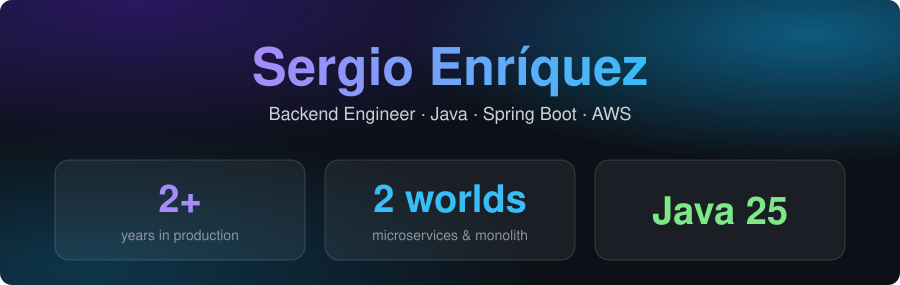
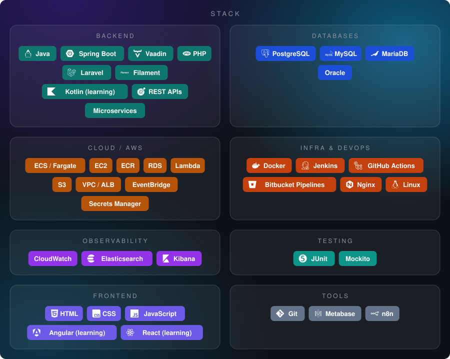

Backend engineer with 2+ years running production systems as the **sole technical reference** for backend and AWS infrastructure.
I've maintained a 6-microservice REST API on legacy Java 8 / Spring Boot 1.5 while **incrementally migrating a Vaadin monolith to Java 25 and Spring Boot 4** — keeping both alive in production along the way.

I care about clean architecture, reliable infrastructure and understanding the systems behind the code.

---

Most of my work lives in private repositories — happy to walk through it in an interview.

